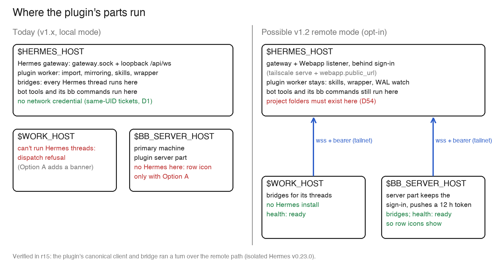

# 15 — Hermes' remote clients, and what they mean for bb-plugin-hermes

Date 2026-11-09. Hermes `v0.23.0` (`2bd378ed1b`); also read: `rc.1-v0.23.1` (`18ac1d528f`), `main` (`38d4cbdf93`), the live `c314285f07`. Plugin `main` v1.0.1, workspace `v110`. Source paths are Hermes `path:line` at `v0.23.0` unless marked.

Labels: **VERIFIED** = run in this round's spike (isolated Hermes `v0.23.0`, stub model). **CODE** = read in source, not run. **READ** = docs or release notes. **INFERRED** = concluded, not run.

## Answer first

- **What shipped:** `v0.23.0` (2026-11-05, stable). Remote access exists for:
  - **Desktop:** a remote URL, SSH or Cloud gateway, with every gateway kept connected at once (READ);
  - **the browser Webapp**, which the gateway itself serves;
  - **the CLI and TUI**, but only through an env var, `HERMES_TUI_GATEWAY_URL`, with no sign-in flow of its own.
- **There is no thin CLI package.** A "thin client" is a full Hermes install pointed at a remote URL.
- **The plugin needs no Hermes on `$WORK_HOST` or `$BB_SERVER_HOST`.** Our own bridge is the thin client. With a 2-seam patch, it ran a whole side-chat turn from a "machine without Hermes" through the remote gateway (VERIFIED, §8).
- **Listing and icon:** remote access solves them for the owner, in a future opt-in "remote mode":
  - every bb machine's bridge can reach Hermes, so health says `ready` everywhere;
  - Hermes is then listed on the primary machine, so row icons appear;
  - no wrong-machine banner or refusal is needed.
- **It doesn't solve them for most users.** Local-only users (D46) never set up remote access, so they still need Option A.
- **It doesn't make the plugin simpler.** Remote mode adds a network credential (reversing D1), sign-in and refresh, a per-machine credential push, cwd rules and offline handling. While local mode stays, it deletes little (§5).
- **Per-machine direction:** Hermes' own model is one gateway per machine, with clients connected to many gateways. Remote access lets any bb machine reach any installation, but each installation still needs its own worker on its own machine (§3).
- **Recommendation:** ship v1.1.0 now with **Option A**, and make remote mode an opt-in v1.2 (§7).

## 1. What shipped

| Version | Date | Remote-relevant |
|---|---|---|
| `v0.22.7` | 2026-11-03 | Patch; notes deferred to `v0.23.0` |
| `v0.23.0` | 2026-11-05 | Webapp served by the gateway (off by default). One gateway owns every session. Desktop keeps every gateway connected. Remote Origin-less ticket dials reach the Webapp gate (`97d75f3eed`, #147361) |
| canaries, `rc.1-v0.23.1` | 2026-11-06 to -09 | `hermes gateway attach` (local clients only); a machine-wide saved-gateways store for Desktop and the Webapp; the TUI keeps images on a remote gateway; `@hermes/shared/gateway-client` (READ, commit log) |
| live `c314285f07` | — | Already has the Webapp listener, sign-in and socket tickets. Lacks `97d75f3eed`, so a remote peer's ticket dial is closed `4403` (CODE) |

**How each client reaches the server:**

| Client | Endpoint and auth | Status |
|---|---|---|
| Desktop "Remote gateway" | A `hermes serve` URL (port 9119), with a session token, password or OAuth | READ. A standalone `hermes serve` has no session authority: its turns run in that process, as Conduit's do, unless the gateway holds the session (CODE `tui_gateway/owner_forward.py:1-17`) |
| Desktop SSH | Opens a tunnel and starts `hermes serve --isolated` on the remote, using the SSH key and an adopted token | READ |
| Webapp (browser) | The gateway's own listener (`webapp.enabled`, port 9120). Either `webapp.host: 0.0.0.0`, or loopback plus `webapp.public_url` behind a proxy. Both need a sign-in gate: a password, or Nous OAuth/OIDC | VERIFIED (API only, no bundle) |
| CLI, TUI, ACP, Python `connect_gateway()` | `HERMES_TUI_GATEWAY_URL=ws(s)://host:port/api/ws?token=<access token>` (`hermes_cli/gateway_client.py:334`). The client "does not acquire or mint remote credentials" (`gateway-classic-cli.md:94`) | CLI `hermes chat -q` VERIFIED; TUI and ACP CODE |
| Our bridge (spike) | `POST /api/webapp/socket-ticket?socket=gateway` with `Authorization: Bearer <access>` returns a one-use, 30 s ticket. Then `/api/ws` with subprotocols `hermes-gateway-v1` and `hermes-gateway-ticket.<t>`, which is today's dial. REST `/api/sessions…` takes the same bearer | VERIFIED |

**Auth** (VERIFIED unless marked):
- **A provider is required.** A gated listener needs one: a password (`dashboard.basic_auth`), OAuth, or the deployment token. Without one, the Webapp stays off and the gateway serves local clients only.
- **The deployment token doesn't open the gateway's Webapp listener.** `HERMES_DASHBOARD_SESSION_TOKEN` registers as a provider, but REST answers `401` and WS answers `403`. On that listener only tokens it issued to a native app's sign-in work alone (`hermes_cli/webapp_sign_in.py:112-121`).
- **Native sign-in** is RFC 8252 PKCE, scripted here:
  1. `/auth/native/authorize`;
  2. `/auth/password-login`;
  3. `/auth/native/token`.
  - It gives an access token for 12 h (`plugins/dashboard_auth/basic/__init__.py:33`) and a refresh token for 30 days (`webapp_sign_in.py:52`).
  - `/auth/native/refresh` rotates both: VERIFIED, a new 12 h token.
- **Restarts:** without `HERMES_DASHBOARD_BASIC_AUTH_SECRET`, every gateway restart signs every client out (`401` after a restart). With it set, tokens survive.
- **Where tokens are kept:**
  - the CLI keeps its token inside the URL in its environment;
  - Desktop and the Webapp keep theirs in `<root>/gateway-connections.json` and `gateway-connection-tokens.json`, as plaintext files with mode 600 (`rc.1-v0.23.1`+, READ).
- **No device pairing.** The release notes' "pairing" means relay grants between gateways for Group Chats, and pairing for messaging platforms (CODE).

**What works over the remote socket:**

| Feature | Result |
|---|---|
| Create, submit, stream, tool events, identity, `persisted-turn` with the `bb:` `submission_id` | VERIFIED: our client, and our bridge |
| Profiles | VERIFIED: the per-call `profile` routes to `alex`. A socket ticket can also carry `profile=` |
| Approvals | VERIFIED: `approval.request` was denied over the socket, and the target folder was left untouched |
| Bot Chat | VERIFIED: created with `hidden` and `follow_profile_config`, then found by `session.list{title, include_hidden}` |
| `profiles.list`, `model.options` (legacy), `runtime.describe` | VERIFIED |
| `/new` as a compaction (`session.mutate compress`) | Inconclusive: `invalid_params` on a 2-message chat, not retested locally |
| Images | Our bridge writes them into `<profile home>/cache/images/`, which is impossible from another machine. A REST `/api/chat/image-upload` exists (CODE); whether `prompt.submit.attachments` accepts its path is unverified |
| `sessions.changed` hint | Root profile only, none for `alex` (VERIFIED; the same as locally, T1.0) |
| Classic CLI slash commands | A reduced set, plus `slash.exec` sent to the owner (READ) |

## 2. Where things run

- **All agent work runs on the gateway's machine:** terminal, file tools, MCP servers, skills and memory (MCP, skills and memory: CODE).
  - VERIFIED: the remote CLI's terminal printed the server's `HOME` and `HERMES_HOME`;
  - VERIFIED: our bridge's turn printed the server profile's `HERMES_HOME`;
  - the CLI warns: "this session uses the gateway's own PATH, toolchain and prefill file: the client's environment was not applied…" (`agent/session_client_env.py:33`).
- **The `cwd` must exist on the server.**
  - The client sends its own `cwd`, and the gateway refuses one that isn't an existing folder there: `invalid_params` `cwd` "must be an absolute path to an existing directory" (`gateway/session_policy.py:443-445`). VERIFIED with a path that exists only on the client.
  - If the same path exists on both machines, the session uses the server's folder of that name. The spike's CLI cwd was accepted only because client and server were one Mac.
  - Our bridge expands `~` on its own machine (VERIFIED: `pwd` gave the bridge machine's home). Remote mode must send server paths only.
- **D54** (a project chat works in the project's folder) holds only on `$HERMES_HOST`, or for a path that also exists there.
  - On another machine, either use the bot's own folder with a note, or refuse.
- **A bot's `bb` commands always run on `$HERMES_HOST`**, as its terminal does, against the bb server. Nothing changes.
  - To act on `$WORK_HOST`, a bot has to start a bb thread there with another provider (`bb thread spawn --machine …`).
- **Not upstream:** Desktop SSH runs terminal tabs on their own host (READ). The third-party `hermes-relay` routes tools back to the client; it's out of scope.

## 3. Our bridge and worker

| Part | Today, on `$HERMES_HOST` | Remote replacement | Status |
|---|---|---|---|
| Bridge socket | `gateway.sock` ticket (`localDial`) | REST socket ticket, bearer | VERIFIED (patch seam 1) |
| Bridge history | `native-http` ticket (`history.ts get`) | Bearer | VERIFIED (patch seam 2) |
| Bridge `model/list` | `model.options` | The same, remotely | VERIFIED |
| Bridge images | `<profile home>/cache/images/` | REST upload | CODE, unverified |
| Bridge role | `worker.json` present | Remote config present, per machine | INFERRED |
| Worker reads: `listSessions`, `readTurns`, `firstSubmissions`, `findBotChat`, `models` | REST and the socket | The same, remotely | VERIFIED (list, messages, `profiles.list`, `session.list`) |
| Worker change watch | `sessions.changed` plus a `state.db-wal` stat every 2 s | Poll REST lists for each enabled bot: no hint arrives for a secondary profile | VERIFIED gap |
| `setBotAccess`: skill, wrapper, `refresh-prompts` | Files, and the folder's own CLI | REST skills routes exist (`POST /api/skills`, `PUT /api/skills/content`); no route for `refresh-prompts` | CODE |
| Version check | `gateway-contract.openrpc.json` | `/api/status` `version`, plus `runtime.describe` | VERIFIED fields; no route serves the contract (CODE) |

- **The worker stays on `$HERMES_HOST`.** D43's wrapper and skill need its files and its bb CLI anyway. Bridges can run anywhere.
- **Hosted bridges:** still one per thread, on the thread's machine; each opens its own remote socket.
- **`stopHosted`:** unchanged. But `diagnostics` reads bridge builds from `bridge-data/bridges/` on the worker's machine only, so the redeploy check (flow 12) must ask every machine.
- **`worker.json`:** becomes a file the server writes on each machine through host RPC: the address, a 12 h access token, the enabled bots and server paths (design, INFERRED).
  - Never put the token in provider options: bb keeps those with every command (INFERRED).
- **Served and unserved bots:** unchanged. The gateway routes by `profile`, and refuses an unserved one with `profile_mismatch` (CODE).
- **Pushes:** unchanged; the server sends them.
- **Bindings:** unchanged. `profile_id` stays the server's path, as the gateway reports it (VERIFIED), so one installation needs no migration.

## 4. The bb side

- **The listing rule** (r13 §1, VERIFIED there): an `installed` provider whose health on the primary machine isn't `not_installed` is listed there, and the row icons follow.
- **With remote mode, the icons appear.** The bridge on `$BB_SERVER_HOST`, a Linux container, can answer `ready` with no Hermes there, so Hermes is listed on the primary machine (INFERRED from r13's matrix plus §8; not run in bb).
- **Health must come from "this machine has a remote config"**, not from a live probe. Otherwise a sleeping `$HERMES_HOST` would unlist Hermes, and the icons would blink out (r13 §2 B).
- **Options A and B:** under remote mode both list Hermes on every machine that has the config.
  - The banner and the refusal then fire only on a machine without access.
  - Their text becomes "Hermes isn't reachable from <machine>", instead of "isn't on".
- **Connection picker:**
  - local mode keeps it;
  - remote mode adds an address and a Sign in button;
  - the worker's machine could be found as the bb machine whose local `identify.instance_id` equals the remote `runtime.describe.instance_id`. Both fields exist (VERIFIED); the match is INFERRED.
- **Detecting a client on a machine:**
  - not by a `hermes` binary or Hermes' config: the CLI keeps no remote config, and Desktop's store holds Desktop's own tokens;
  - instead: a ready local `gateway.sock` means local; else the plugin's remote config means remote; else neither.

## 5. Simplification

| Item | If remote mode were the only mode | With local mode kept (D46) |
|---|---|---|
| Wrong-machine refusal and its text (`src/server/dispatch.ts`, `otherMachineText`) | Delete | Keep; rarely shown |
| A's banner, one-time switch and "Moved to" note | Delete | Keep |
| The placeholder model off the Hermes machine (`composer.ts`) | Delete | Keep |
| Machine picker (`connection-section.tsx`, `setConnection`) | Replace with an address and Sign in | Keep, and add those |
| `gateway.sock` discovery (`src/hermes/control.ts`) | Keep for the worker | Keep |
| REST with `native-http` (`history.ts`) | Add a bearer variant | Both |
| Image staging | Replace with a REST upload | Both |

- **Remote mode adds:**
  - sign-in: a password, or OAuth through a browser with PKCE;
  - a token kept in the server's secrets, with refresh;
  - a push of the address and token to each machine;
  - the remote dial and remote REST;
  - offline handling inside the bridge;
  - per-machine diagnostics.
- **Net: more code.** Remote-only would force every user to expose a network listener behind a sign-in, which is a security step back for single-machine users. Local mode stays.

## 6. Costs and risks

**Minimum Hermes version:**
- **`v0.23.0`** for a direct remote ticket dial (`97d75f3eed`).
- The reverse-proxy shape the spike used may already work on the live `c314285f07`, which has no `97d75f3eed`. Its proxy peer is loopback, and that path is the same code there (CODE, not run).
- The plugin's `contract:check` passes on `v0.23.0`, `rc.1-v0.23.1` and `main` (VERIFIED).

**Owner setup** (on `$HERMES_HOST`; the owner's own changes, never the plugin's):
1. Update Hermes to `v0.23.0` or later.
2. Set `webapp.enabled: true`. Either:
   - **(recommended)** keep the loopback host, run `tailscale serve` for HTTPS, and set `webapp.public_url: https://$HERMES_HOST_TS.$TAILNET`. This reaches the tailnet only, over HTTPS;
   - or set `webapp.host: 0.0.0.0`. That also opens the LAN, over plain HTTP.
3. Set up a sign-in provider: `dashboard.basic_auth.{username,password_hash}` plus `HERMES_DASHBOARD_BASIC_AUTH_SECRET`, or Nous OAuth.
4. Restart the gateway.
5. In bb (v1.2), enter the address and sign in once.

On the other machines:
- **`$WORK_HOST`, `$BB_SERVER_HOST`:** nothing for the plugin. Both are already on the tailnet.
- **A thin CLI for the owner's own shell** would take:
  - a full install: a checkout plus a Python 3.14 environment, here 145 MB of core dependencies with no extras;
  - an alias that sets `HERMES_TUI_GATEWAY_URL`, since the token in the URL expires after 12 h;
  - a dummy local `model:` block.
- **Without the env var, `hermes` starts a local gateway** (`connect_gateway`). That makes a second Hermes, with its own chats, on that machine (CODE).

**Security:**
- **A signed-in client is the owner.** "A signed-in Webapp user can run arbitrary commands as the OS account running Hermes…" (`desktop.md`, READ). It covers every profile, approvals, the host terminal, config and `.env`.
- **The credential would spread.** Remote mode puts that credential on every bb machine's plugin data folder and in the bb server's secrets. Today only same-UID socket tickets exist (D1).
- **Password sign-in is for trusted networks only**, per the docs. Use OAuth for anything public.
- **`0.0.0.0` exposes the listener on every interface.** Prefer `tailscale serve`.
- **Who can drive the bots:** anyone who can use bb, as today. Now from a bridge on any machine.

**When `$HERMES_HOST` sleeps:**
- A thread on another machine stays online in bb, so bb won't hold its sends. The bridge must hold them itself and show "`$HERMES_HOST` is offline" (INFERRED).
- The worker sleeps too, so mirroring waits until it wakes, as today (flow 10).
- A dropped socket redials and replays from `events.since`, as after a gateway restart (flow 8).

**Migration:**
- No change to existing bindings, which keep the same `profile_id`s.
- Existing threads stay on `$HERMES_HOST`: bb doesn't move a thread's machine.
- Several installations later would need an installation key in `bindings`, since home paths can collide across machines.

**Upstream maturity:**

| Surface | Since | State |
|---|---|---|
| Desktop remote | `v0.16.0` (2026-06-05) | Stable, documented |
| Webapp | `v0.23.0` | New, off by default |
| CLI and TUI remote URL | — | Undocumented for users: the TUI docs call it "not a user-facing remote-attach knob" (`tui.md:300`), and "remote login bootstrap" is still open (`gateway-classic-cli.md:88-94`) |
| Remote ticket fix | 2026-11-01 | Fresh |
| Saved-gateways store, `gateway attach` | 2026-11-07 canary | `rc.1-v0.23.1` |

## 7. Recommendation

1. **Ship v1.1.0 as built, with Option A (recommended).**
   - Listing: A, `always`, with the banner and the one-time switch.
   - It works for every user with no Hermes-side setup, and gives everyone icons.
   - Remote mode later only adds machines where the banner never shows.
2. **Ship v1.1.0 with B, and remote mode in v1.2.**
   - Listing: B now, then "ready wherever a bridge reaches Hermes".
   - The owner has no row icons until v1.2.
3. **Hold v1.1.0 and build remote mode now.**
   - Listing: ready wherever a bridge reaches Hermes.
   - It waits on the owner's Hermes upgrade and network exposure, and on reversing D1. It is more code and a delay.
   - Not recommended.

**v1.2 remote mode, if chosen** (opt-in, local mode unchanged):
1. Settings take a Hermes address and a Sign in. The server keeps the refresh token and refreshes it.
2. The server writes the address and the access token through host RPC to each online machine's plugin data folder.
3. The bridge dials remotely, uses bearer REST, uploads images, sends only server paths, and holds sends while Hermes is offline.
4. Health is `ready` wherever the config exists. The banner and the refusal fire only where it doesn't.
5. The worker stays on `$HERMES_HOST`: skills, `refresh-prompts`, the WAL watch and the wrapper.
6. D54 off `$HERMES_HOST`: the bot's own folder, with a note.

## Questions for the owner

1. v1.1.0 listing: **(a) A (recommended)**; (b) B.
2. Remote mode in v1.2: **(a) yes, opt-in (recommended)**; (b) not now.
3. Exposure: **(a) `tailscale serve` plus `webapp.public_url` (recommended)**; (b) `webapp.host: 0.0.0.0`.
4. Sign-in: **(a) password, on the tailnet only (recommended)**; (b) Nous OAuth.
5. A project chat on a machine without the project's folder on `$HERMES_HOST`: **(a) the bot's own folder, with a note (recommended)**; (b) refuse.

## 8. Spike (what ran)

**Setup:**
- **Clone:** a clone of the live repo under `/private/tmp`, its remote removed, then GitHub fetched into it. Checked out `v0.23.0`.
- **Environment:** `uv sync --frozen --no-dev` into its own venv, Python 3.14.
- **Isolation:** `HERMES_HOME`, `HOME`, `TMPDIR` and `HERMES_GATEWAY_LOCK_DIR` were all under `/private/tmp`, with `TZ=UTC`.
- **Profiles and model:** `default` and `alex`, with a stub model on loopback.
- **Listener:** the gateway listened on loopback port 39120, with `webapp.enabled` and `webapp.public_url` set to the tailnet address, port 39121.
- **Forwarder:** a stdlib TCP forwarder on the tailnet address stood in for `tailscale serve`.
  - It ran under the system Python, which the macOS firewall already allows. A direct wildcard bind from the unsigned interpreter would have raised a firewall prompt on the owner's screen.

**Results:**

| Step | Result |
|---|---|
| `/api/status` over the tailnet address | `auth_required: true`; providers `basic`, `session-token` |
| Deployment token as a bearer, or as `?token=` | `401` and `403` |
| Native sign-in (scripted PKCE) | Tokens: 12 h access, plus refresh |
| A thin `hermes chat -q 'run: pwd; …'` from a client home with no sessions | Created a session on the server; the tool ran with the server's `HOME` and `HERMES_HOME`; the client home has no `state.db` |
| The same, with an empty client config | Refused locally: "isn't configured yet" |
| Our `HermesClient`, unchanged, with a REST ticket | `describe`, `profiles.list`, `create`, `submit`, events, `session.list`, REST list and messages all OK. A client-only `cwd` was refused |
| Approval | `deny` resolved; the target survived |
| Change hints | `sessions.changed` for `default` only |
| Gateway restart | Tokens died without the secret, and lived with it; refresh rotated them |
| **Our bridge** (`createBridge`, 2 seams patched) on "work-host", driven by bb's JSON-RPC: `thread/start` then `turn/start` | `commandExecution` and `agentMessage` items, `turn/completed` in 0.2 s, identity `…/profiles/alex#local-…`, `persisted-turn` with `bb:thr_r15work:creq_…` |

**Not done:**
- **The isolated bb with a second machine:** skipped for time. The remote half is covered here, and r13 verified bb's two-machine bridge hosting. The parent was not told, because the isolated bb wasn't started.
- **The TUI:** not built.
- **Desktop:** not run.
- **A direct wildcard bind:** skipped because of the firewall prompt.

**Safety:**
- The live gateway pid was unchanged.
- No client touched the live gateway, and the spike wrote nothing in `~/.hermes`.
- Every spike process was stopped.

**Patch and drivers:**
- the patch: `/tmp/bb-spikes/r15-spike.diff` (`src/hermes/client.ts`, `src/hermes/history.ts`), never committed;
- the drivers: `/tmp/bb-spikes/r15-scripts/`.

## Odd findings

- The TUI docs call `HERMES_TUI_GATEWAY_URL` dashboard-internal, yet the code and recent commits support gateways on other machines.
- The classic CLI's first-run guard (`hermes_cli/main.py:1705-1707`) demands a local provider even with a remote URL. `OPENAI_BASE_URL` alone fails later with "not connected to any AI provider"; a dummy `model:` block works.
- The deployment session token registers as a provider but can't open the gateway's Webapp. Per the code it works only on `hermes serve` and the dashboard (`webapp_sign_in.py:117-118`).
- `hermes serve`, Desktop's documented remote backend, still runs legacy turns in its own process (CODE).
- A `hermes chat -q` session is stored as `oneshot`, which the plugin's allow-list keeps out, remotely as locally.
