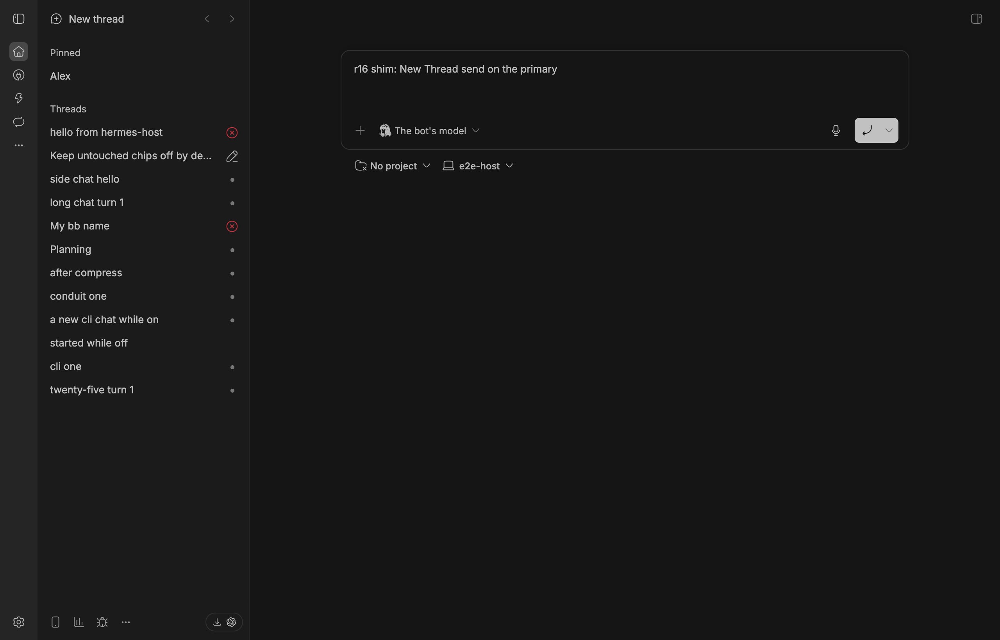
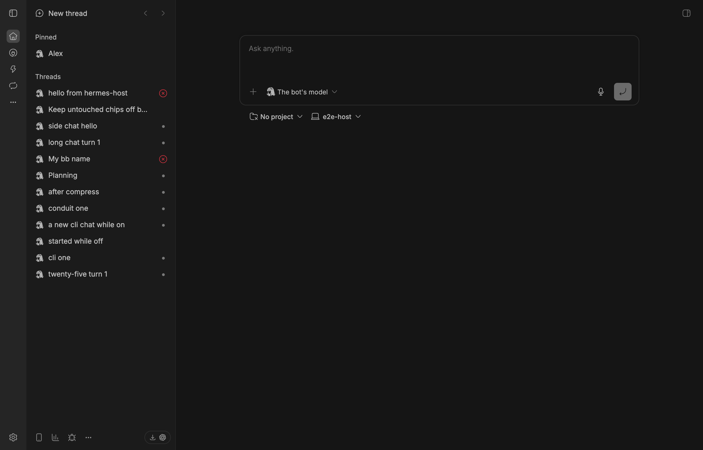
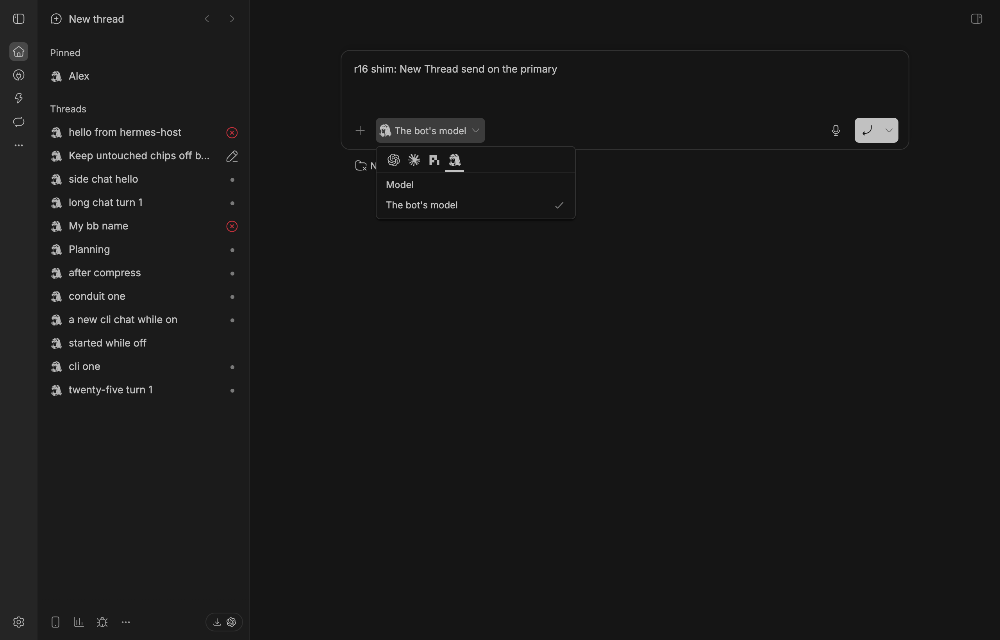
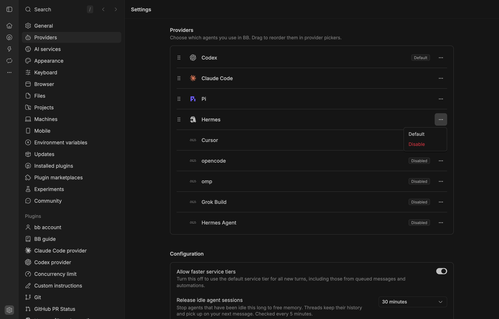
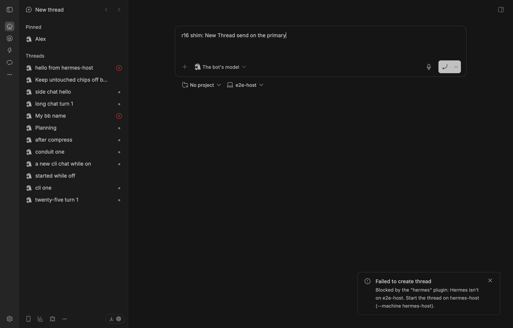
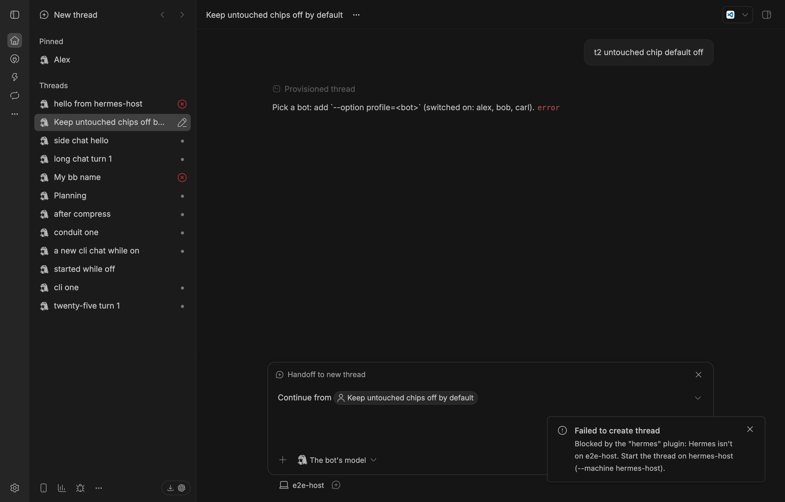
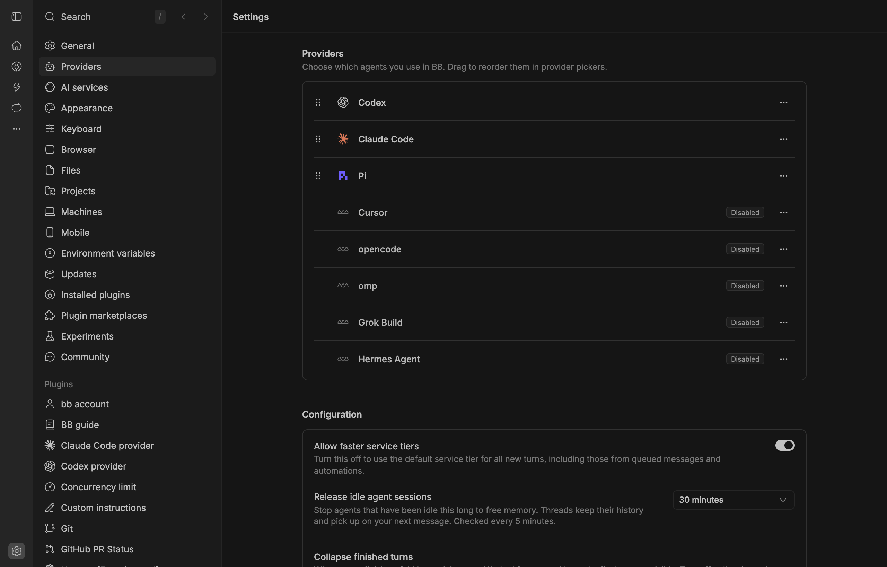

# 16 — A primary-machine shim for the Hermes row icon

Date 2026-11-09. bb-app 0.49.0. Plugin code: the build's listing-B commit `f2c7d6ca` (D56), run unchanged. Isolated bb `~/.bb-hermes-e2e` with two machines: the bundled daemon `e2e-host` (the primary, without Hermes) and a second host daemon `hermes-host` (the Hermes machine, serving the strict fake). Headless Chrome for Testing in UTC.

Labels: **RAN** = done on the isolated bb (CLI, screenshot, file check). **CODE** = read in the plugin or bb's shipped code, not run. **INFERRED** = concluded, not run.

## Answer first

- **Possible: yes.** The smallest shim is one hand-written file on the primary machine, `<bb data dir>/plugins/hermes/bridge-data/worker.json`:

  ```json
  {"root":"/nonexistent/hermes-shim","worker_boot_id":"shim","written_at":0,"enabled":[]}
  ```

- **It needs no refresh.** Listing B's rule is "`worker.json` parses", with no age check. No cron.
- **What it gives (RAN):**
  - the Hermes icon on every Hermes row;
  - a Hermes tab in the primary's New Thread, showing only "The bot's model" and no bot chip;
  - a Hermes row in Settings → Providers, with **Default** and **Disable**.
- **Picking Hermes there always fails with our refusal (RAN):** "Hermes isn't on <primary>. Start the thread on <Hermes machine> (--machine <Hermes machine>)." This held for a New Thread send, `bb thread spawn`, Handoff, and a send in an old thread. No thread is created.
- **The refusal doesn't depend on the shim.** The server's `message.dispatch` hook compares host ids. The shim's fake `root` also keeps the primary's bridge from passing its own check and from dialling anything.
- **Main risk (RAN): Default.**
  - Clicking Default on the Hermes row makes every provider-less thread go to Hermes, from any machine. Off the Hermes machine it is refused.
  - If the shim is later removed while Hermes is default, the Hermes row disappears. Settings then shows **no** Default badge at all, yet provider-less spawns still go to Hermes.
- **Plugin change:** recommended, small. Let the bridge also list on a separate marker file (`bridge-data/list-here`). The shim then stops faking `worker.json` (§5).

## 1. The shim

### What it can be

| Form | Works? | Why |
|---|---|---|
| **A `worker.json` file** | **Yes (RAN)** | Health is `ready` iff `readWorkerFile(dataDir) !== null` (`src/bridge/bridge.ts`, `f2c7d6ca`) |
| A symlink | Only as that same file | A link to the Hermes machine's real file can't cross machines. A local link is the file with extra steps |
| An env var | No (CODE) | `provider/health` gets only `{providerId, cwd?, providerOptions}`. Its `providerOptions` are the registration's static `experimental_bridgeOptions`, the same on every host. The bridge's env is only `envPassthrough`, and its argv is the artifact, the plugin id and its `dataDir` (daemon `HY`, `buildCommandPlan`) |
| A fake `hermes` binary | No (CODE) | It lists provider-acp's `acp-hermes-agent` ("Hermes Agent", command `hermes acp`, its own icon), a different provider id. Our rows use provider `hermes`, so they stay without an icon. It would also add a broken second Hermes row |

### Rules for the file

- **Path:** `<data dir>/plugins/hermes/bridge-data/worker.json`. The data dir is the one `bb status` prints as `Data dir` on the primary. The bundled daemon shares it: RAN, `~/.bb-hermes-e2e/plugins/hermes/bridge-data/`.
- **Schema is strict** (`workerFileSchema.strict()`): exactly `root`, `worker_boot_id`, `written_at` (a number) and `enabled` (an array). An extra or missing field makes it fail to parse, and Hermes is silently unlisted.
- **`root` must not be the Connection's folder.** The bridge's own machine check is `sameFolder(worker.root, options.folder)` (`src/bridge/context.ts`).
- **`enabled` must be `[]`.** `model/list` then answers the placeholder and dials nothing (`bridge.ts` `modelList`).
- **Never copy the Hermes machine's real `worker.json`** (CODE). With the real `root` and bots, the primary's bridge passes its own check. Its New Thread shows a bot chip, and `model/list` tries `<root>/gateway.sock` on a machine without Hermes. Sends are still refused by the server hook, but the backstop is gone.

### Build thread's three candidate rules

| Candidate | Smallest shim |
|---|---|
| **Fresh `worker.json` (chosen, without an age check)** | The file above, once |
| Same, with an age check on `written_at` | The file plus a timer that rewrites `written_at`, e.g. a loop or systemd timer. A container may have no cron. A far-future `written_at` passes only if the rule doesn't reject future times. Fragile |
| A host-side marker file | The same idea at the marker's path. Not possible if the marker carries something the server checks, such as the worker's boot id |
| Health reads `providerOptions` | **Not possible as bb stands** (CODE): health gets no host id and no derived options. If the plugin put the Hermes host id in `experimental_bridgeOptions`, the bridge would also need its own host id. It could read `<data dir>/host-id` three levels above its `dataDir`, but that's bb's private layout. A shim would then have to fake `host-id`, which breaks the daemon |

## 2. What changes on the owner's setup




| Surface | Without shim | With shim | Evidence |
|---|---|---|---|
| Sidebar rows | no icon | Hermes icon | RAN, above |
| Primary's New Thread | no Hermes tab | Hermes tab; model "The bot's model"; no bot chip | RAN, `16-shim-picker.png` |
| Settings → Providers | no Hermes row | Hermes row; its menu has **Default** and **Disable** | RAN, `16-shim-settings-menu.png` |
| `bb provider list` (primary) | no `hermes` | `hermes` | RAN |
| Other machines | unchanged | unchanged | CODE: listing is per machine |
| Health text on the primary | "Hermes runs on another machine." | "Hermes runs on this machine." (wrong, and not shown on these surfaces, r13 §1) | CODE |




**When it takes effect: the 5-minute cache** (CODE `start-server.js:237187`, RAN):
- bb caches each machine's answer in memory for 5 min, stale-while-revalidate. The first listing after expiry still shows the old answer and refreshes it in the background.
- RAN: Hermes appeared on the primary 138 s after the file was written, without a reload. Removing it behaves the same.
- **`bb plugin reload hermes` applies it at once** (RAN). A server restart clears the cache too.

**Does it survive?**

| Event | Shim | Evidence |
|---|---|---|
| Keep-alives (60 s), 2 cycles | kept | RAN |
| Re-saving the same Connection | kept | RAN (`release` only targets a machine the Connection moved off) |
| Connection → Not connected → back | kept | RAN (only the Hermes machine's file was released and rewritten) |
| `bb plugin reload hermes` | kept | RAN |
| Plugin reinstall (same version) | kept | RAN |
| bb server restart | kept, listed again | RAN |
| **Connection moved onto the primary, then off** | **replaced, then deleted** | RAN: the worker overwrote it; `release` then removed it |
| Container restart | kept, if the data dir is on a persistent volume (bb's `bb.db` lives there too) | INFERRED |
| bb update | kept | INFERRED: updates don't touch `plugins/*/bridge-data` |
| bb server move | **lost** | CODE: the server-move copy skips `plugins/<id>/bridge-data` (daemon bundle `BYe` set) |
| Plugin update that changes `worker.json`'s fields | **silently unlisted** | CODE: strict schema |

## 3. What picking Hermes there does — RAN

| Path | Result | Thread created? |
|---|---|---|
| New Thread send on the primary | Toast "Failed to create thread · Blocked by the "hermes" plugin: Hermes isn't on e2e-host. Start the thread on hermes-host (--machine hermes-host)." Draft kept | no |
| `bb thread spawn --provider hermes --machine <primary>` | `Error: Failed to create thread: HTTP 409: Hermes isn't on e2e-host. Start the thread on hermes-host (--machine hermes-host).` exit 1 | no |
| Handoff to new thread → Hermes, on the primary | Same toast | no |
| Send in an old Hermes thread on the primary | "Failed to send message · Blocked by the "hermes" plugin: …" (same text) | — |
| **Default** on the Hermes row, then `bb thread spawn` without `--provider` on the primary | Same 409 refusal | no |
| Default, then remove the shim | Hermes row gone, **no Default badge on any row**, and provider-less spawns still go to Hermes and are refused | no |
| Disable | Stops every Hermes turn, wake and import everywhere | r13 §8, not re-run |





- **Never silent:** every refusal above came from the server's dispatch hook (`src/server/dispatch.ts`), which compares the thread's host id with the saved Hermes machine. bb itself doesn't check listing at create time (CODE `resolveCreateThreadExecutionDefaults`), so these paths behave the same with or without the shim.
- **Never touches Hermes:** the primary's bridge has `root: /nonexistent/hermes-shim` and `enabled: []`. So `model/list` dials nothing and `resolveContext` refuses before any dial (CODE). The Handoff test started from a Hermes thread; from a Codex, Claude or Pi thread it's the same create path (INFERRED).

## 4. Risks

**Can the shim fool other parts of the plugin?** (CODE, `f2c7d6ca`)

| Part | Affected? |
|---|---|
| Server: Connection, keep-alive, discovery, imports, pushes, diagnostics | No: it calls only the saved machine (`hostId: current.machine`, `target.machine`, `health.machine.id`) |
| `release` | Only machines the Connection moved off; the primary isn't one unless the Connection was there |
| Worker | Runs only where the server calls it |
| Connection picker | Lists bb machines from `hosts.list`, not health |
| Dispatch hook | Decides by host id, not by files |
| Primary's bridge | Reads the file for health (the point), `model/list` (`enabled` → chip and catalog via `root`), and `resolveContext` (`root` vs the folder). With the shim's values: listed, placeholder model, refusal |

**If the owner forgets it's there:**
- **Default / Disable** sit one click away on a machine where Hermes can't run (above). Removing the shim while Hermes is default hides the default.
- **Silent loss:** a plugin update that changes `worker.json`, a server move, or moving the Connection onto the primary removes the listing with no message. The icons just go.
- **Misleading health text:** "Hermes runs on this machine."
- **Leftover:** it does no harm after Hermes or the plugin is removed. With no bridge, nothing reads it.

## 5. Should the plugin change?

**Option M — "also list on the primary machine"**, a setting, default off:
- the server learns `primaryHostId` and writes a marker on that machine through host RPC (a new `listHere {on}`);
- the bridge answers listed if `worker.json` **or** the marker exists.

**M-lite — a documented marker file, no setting:**
- the bridge also answers listed if `bridge-data/list-here` exists, with any content;
- the owner creates it by hand.

| | Shim as is | M-lite (recommended) | M (setting) |
|---|---|---|---|
| Plugin code | none | ~5 lines + 1 test | setting, host RPC, server sync, tests |
| Fakes `worker.json` | yes | no | no |
| Tied to `worker.json`'s schema | yes | no | no |
| Deleted by `release` or a Connection move | yes | no (`release` removes only `worker.json`) | rewritten at keep-alive |
| Survives a server move | no | no | yes |
| Health text can be honest | no ("runs on this machine") | yes (e.g. `unknown`, "Listed here; Hermes runs on another machine.") | yes |
| Default / Disable trap | yes | yes | yes |
| Discoverable by others | no | docs only | Settings |

- **Recommend M-lite.**
  - It turns the shim into a supported knob for 5 lines. It avoids the strict-schema and `release` traps, and it keeps the bridge's role signal (`worker.json`) true.
  - Answer `unknown` (still listed, r13 §1 matrix), not `ready`, so bb's "prefer a ready provider" default never picks Hermes there.
- **M** only if other users ask, or if bb hasn't drawn icons from each thread's own machine by v1.2. It's more surface for a gap bb may close.
- **Neither fixes the Default trap.** A one-line ops note covers it: set another provider as Default before removing the shim or marker.

## Owner setup (generic)

On the primary machine without Hermes:

```sh
d="<Data dir from bb status>/plugins/hermes/bridge-data"
mkdir -p "$d"
printf '%s\n' '{"root":"/nonexistent/hermes-shim","worker_boot_id":"shim","written_at":0,"enabled":[]}' > "$d/worker.json"
bb plugin reload hermes
```

- Don't click **Default** on the Hermes row.
- To undo: make another provider Default if Hermes is, delete the file, then run `bb plugin reload hermes`.

## Odd findings

- A restored New Thread draft keeps Hermes picked on the primary even when Hermes isn't listed there (`16-no-shim-rows.png`); its send gets the same refusal.
- The Settings row menu item is "Default" (a checkbox item), not "Make default".
- After a Hermes default loses its row, Settings shows no default at all.
- The shim's health message says "Hermes runs on this machine.", from the `here` branch.
- The listing cache made the change visible 138 s later. A plugin reload is the reliable way.

## Method and safety

- **Setup:**
  - installed the build's code (`bd09a49a` = `f2c7d6ca` + docs) with the server only, then started the fake and bb-app;
  - enrolled a second daemon through `POST /api/v1/hosts/join-codes` on port 48888, with its data under `/private/tmp`, and renamed it `hermes-host` before any screenshot;
  - set the Connection to it, which released `e2e-host`'s `worker.json` (RAN);
  - turned Alex on, so rows existed.
- **Shim tests:** `/tmp/bb-spikes/r16-scripts/shimcheck.sh` compared the file's hash and `bb provider list` after each event in §2.
- **No plugin code was edited.** `/tmp/bb-spikes/r16-spike.diff` records that, and the shim file.
- **One slip:** during one reinstall, with the server only, the second daemon was still stopping (SIGTERM was slow; SIGINT worked). The folder was the test root.
- **Cleanup:**
  - Alex off, then the Connection back to `e2e-host`, which rewrote its real `worker.json`;
  - the shim was trashed, `hermes-host` removed and its data dir trashed;
  - the plugin was reinstalled from the build workspace, then bb-app, the fake and Chrome were stopped;
  - one Alex bot thread from this run remains, on the removed machine.
- **No live access:** live bb, the live bb server, live Hermes and `~/.hermes` weren't touched.
